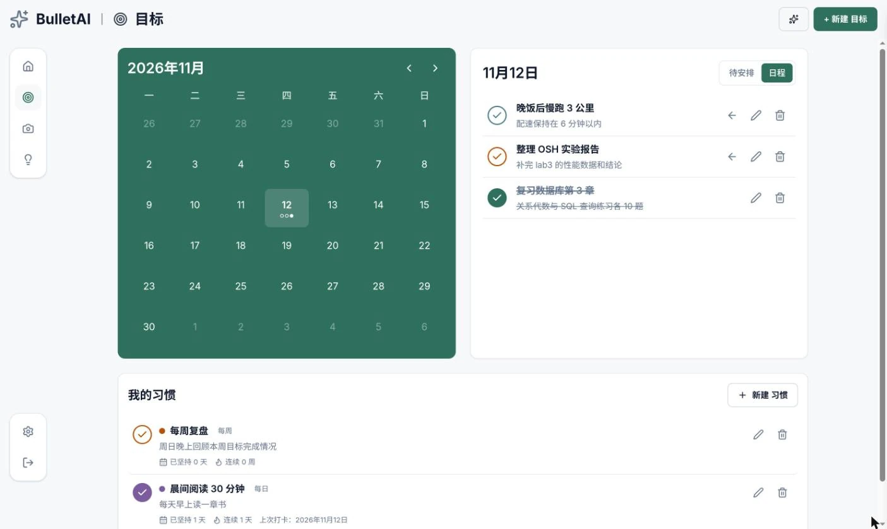

## 简介

和 operator 合作开发的个人工作区。Moments（图文记录）、Reflections（感悟）、Goals（目标）、Habits（习惯）都汇总到 Today 页面。AI 只用来把大目标拆成可执行的步骤，不做闲聊。

2025 年 8 月和 operator 一起起步；2026 年 6～7 月，我把数据层重构成 local-first 架构。

（截图中的目标、习惯和感悟都是演示数据。）

## 亮点

- Local-first 数据层：IndexedDB 保存近期快照和持久化写队列，页面不等网络就先渲染；后台同步 worker 在 Web Lock 下运行，用 `clientId` 让创建可以幂等重试，用 `version` 做 CAS 更新。遇到冲突不会静默覆盖，而是保留成冲突草稿，在设置页逐字段对比后由用户处理。
- 增量同步：基于 change-log 游标只拉取变更行和删除 tombstone；完整历史用 keyset 游标分页加载。
- 用 Supabase RLS 做数据隔离，配 pgTAP 数据库契约测试；AI 请求只走服务端路由，限流由数据库函数强制执行。

## 技术栈

Next.js 15 · React 19 · TypeScript · Tailwind CSS v4 · TanStack Query v5 · IndexedDB · Supabase（Auth / Postgres / Storage / RLS）· Vitest · pgTAP

## 状态

已上线，bullet-ai.vercel.app 运行的是 2026 年 7 月重构后的版本。

## 仓库

::github{repo="mirawind/Bullet-AI"}
