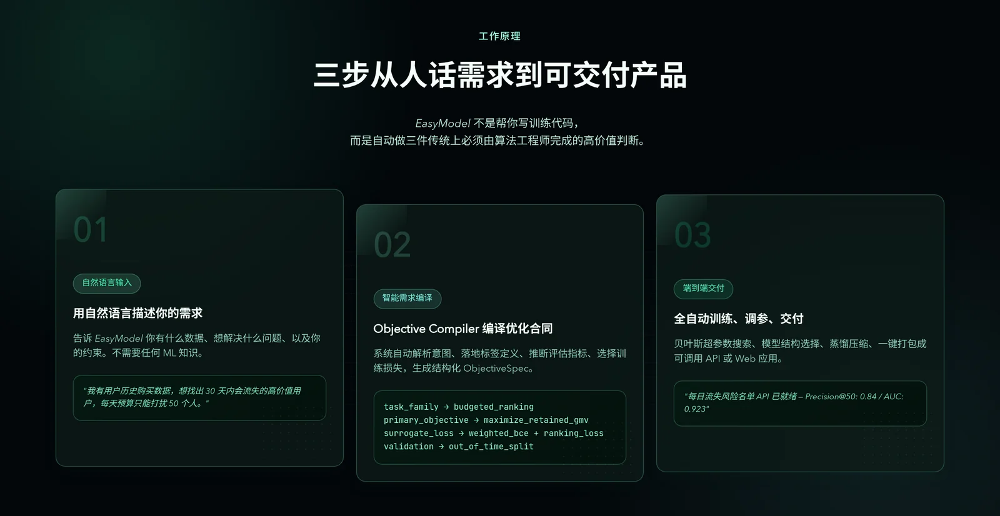
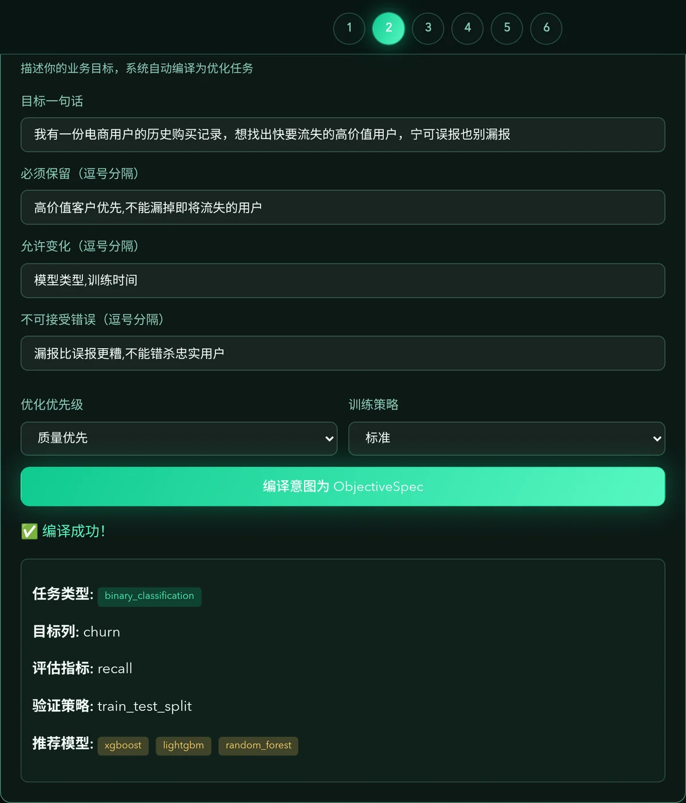
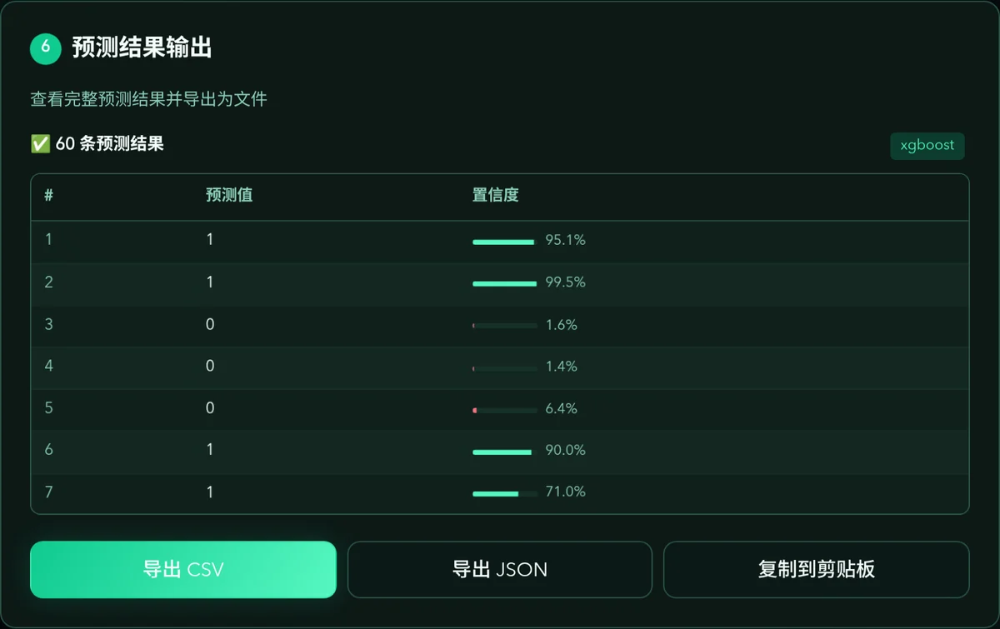

## 简介

2026 年 4 月小红书黑客松（RedHackathon）的团队参赛作品。用户上传表格数据，再用自然语言写下目标，比如「预测用户是否会流失，宁可误报也别漏报」。系统把需求编译成结构化的建模目标，自动训练和调参，最后交付模型权重、预处理器和批量预测接口。

## 主要功能

- 对话式建模：在 Chat 页面上传数据（CSV、Excel、ZIP、7Z），用自然语言描述需求，得到为该场景定制的训练方案。
- 数据获取：没有现成数据时，可以让 Agent 搜索公开数据集、生成合成数据，或者通过链接导入。
- 需求编译：把一句话目标、必须保留的约束和不可接受的错误，编译成 ObjectiveSpec（任务类型、目标列、评估指标、验证策略、推荐模型）。
- 自动训练：AutoML 使用 vast.ai 上的算力，利用 XGBoost、LightGBM、随机森林等机器学习模型或深度学习模型和超参数之间搜索，训练过程可以暂停、继续或停止。
- 交付与预测：下载模型权重和预处理器；上传新数据批量预测，结果可以导出为 CSV / JSON。
- 知识页面：提供模型百科和专题讲解，介绍 XGBoost、Transformer、贝叶斯优化等常见方法。

## 推广视频

<iframe src="https://player.bilibili.com/player.html?bvid=BV1n5DZBdEBk&p=1&autoplay=0" title="EasyModel 推广视频" style="width: 100%; aspect-ratio: 16 / 9;" scrolling="no" frameborder="0" allowfullscreen="true"></iframe>

[在哔哩哔哩观看](https://www.bilibili.com/video/BV1n5DZBdEBk)

## 界面截图

## 我的分工

- 产品细节设计：具体功能和使用流程的设计。
- UI/UX：原型的设计与开发。
- 参与推广视频（剪映制作）的讨论。

## 亮点（团队作品）

- 双路需求编译：配置了 LLM 时由模型生成 `ObjectiveSpec`；没有配置或调用失败时退回规则编译，整条流程照样能跑通。需求太含糊时先做歧义检测并追问。
- 训练按数据模态分流：表格数据在本地跑 AutoML，用 scikit-optimize 的高斯过程做贝叶斯超参数搜索，配合分层 K 折交叉验证和早停；其他模态生成训练代码，交给 Modal 云端 GPU（T4～H100）执行。
- FastAPI 后端支持大文件分块上传，Agent 的进度通过 SSE 实时推送到前端；整套服务可以用 Docker 部署。

## 技术栈

Python · FastAPI · XGBoost / LightGBM / scikit-learn · OpenAI 兼容 LLM · Docker

## 状态

比赛结束后不再维护，在线 Demo 目前仍可访问。

## 仓库

::github{repo="VibeML-team/EasyModel"}
