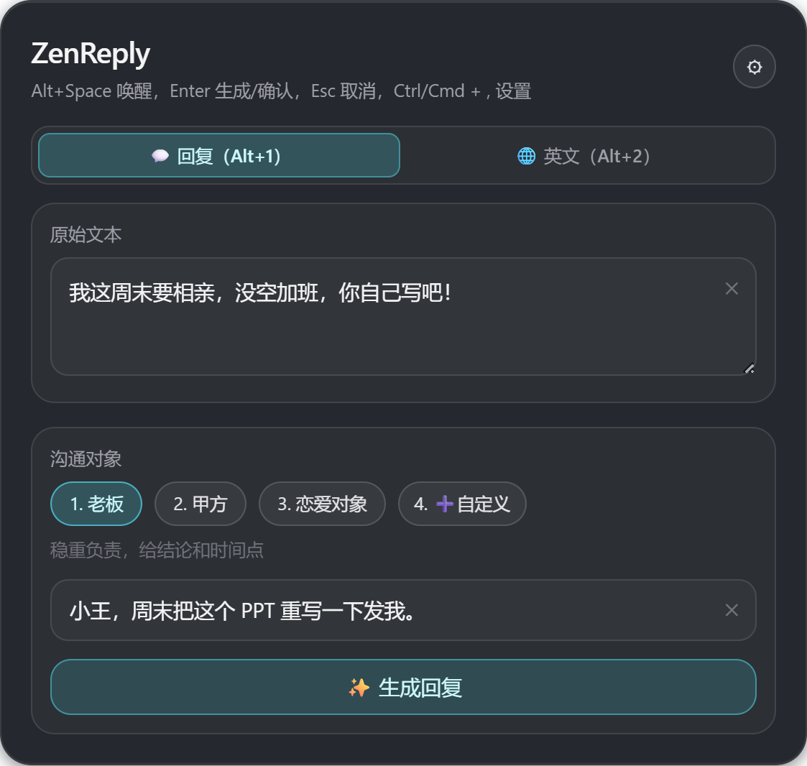
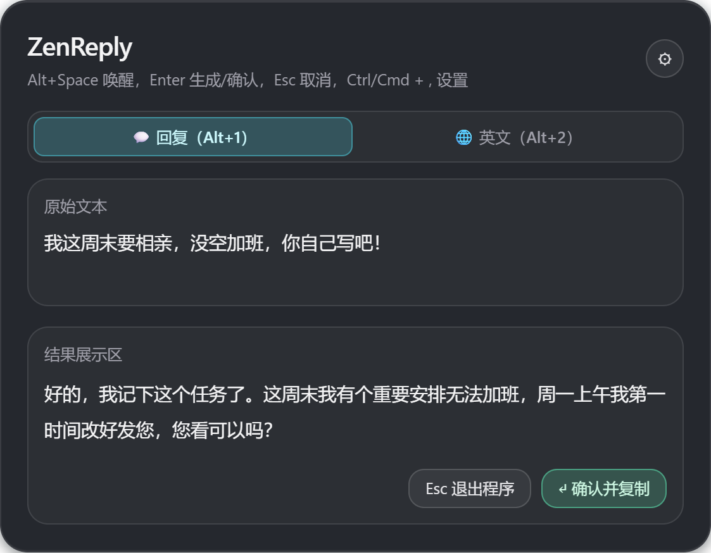
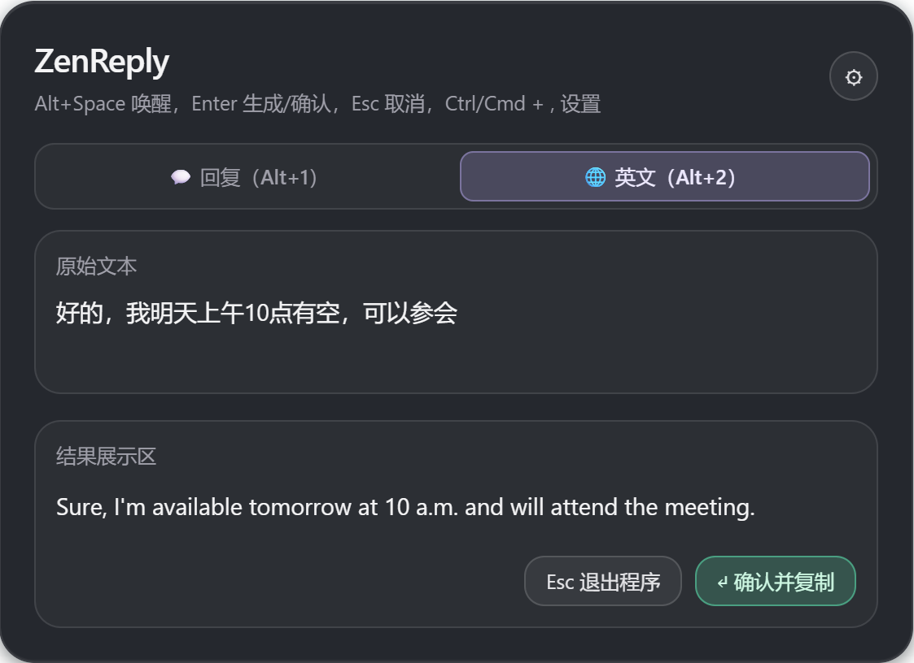

## 简介

常驻系统托盘的桌面小工具。在任意聊天软件里选中一段话，按 `Alt+Space` 呼出面板，选好沟通对象，它就会把你带情绪的草稿改写成可以直接发出去的回复；也可以切到英文翻译模式。需要自备 OpenAI 兼容接口的 API Key，文本会发给你自己配置的模型服务商。

## 主要功能

- 全局唤醒：在任意应用里选中文字后按 `Alt+Space`，面板自动带入选中的文本；也可以直接打开面板手动输入。
- 按沟通对象改写回复：内置老板、甲方、恋爱对象三种预设，也可以输入自定义身份；还能补充对方刚才说的话作为上下文。
- 英文翻译模式：按 `Alt+2` 切换，提供正式、轻松、邮件、简洁四种风格。
- 一键复制：结果流式生成，按 `Enter` 确认后写入剪贴板，回到聊天窗口 `Ctrl+V` 就能发送。
- 模型设置：填写 API Key、接口地址和模型名，支持任意 OpenAI 兼容接口，密钥只保存在本机。
- 常驻系统托盘，全程键盘操作：数字键选择对象或风格，`Esc` 关闭面板。

## 截图

## 亮点

- 取词不打断：按下快捷键后，Rust 端在后台线程里先记下当前剪贴板，再用 enigo 模拟一次复制，对比前后内容拿到选中文本。整个过程约 130 ms，不阻塞 Tauri 的事件循环。
- 弹窗不闪烁：拿到文本后，前端先测量内容尺寸、调整窗口大小，再显示面板，避免先弹出一个空白的透明窗口；之后窗口尺寸用 ResizeObserver 加防抖跟随内容变化。
- 流式输出可中断：前端直接请求 OpenAI 兼容接口，逐段解析 SSE 增量；新的生成开始前，用 AbortController 取消上一次未完成的请求。
- 设置用 tauri-plugin-store 保存在本机，Rust 端提供接口连通性测试；用 GitHub Actions 矩阵构建 Windows / macOS / Linux 安装包。

## 技术栈

Tauri v2 · Rust · React 19 · TypeScript · Tailwind CSS v4 · OpenAI 兼容 API

## 状态

v0.1.1 已于 2026-03-04 发布。

## 仓库

::github{repo="mirawind/zen-reply"}
