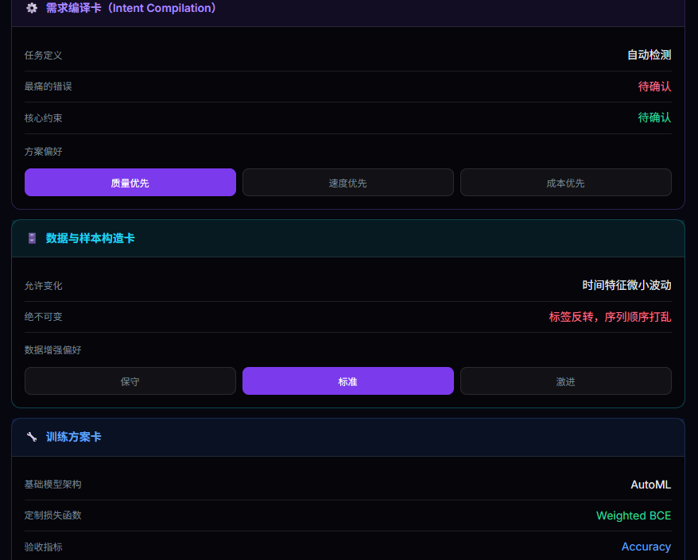

## 简介

2026 年 4 月小红书黑客松（RedHackathon）的团队参赛作品。用户上传表格数据，再用自然语言写下目标，比如「预测用户是否会流失，宁可误报也别漏报」。系统把需求编译成结构化的建模目标，自动训练和调参，最后交付模型权重、预处理器和批量预测接口。

## 我的分工

- 产品细节设计：具体功能和使用流程的设计。
- UI/UX：原型的设计与开发。
- 参与推广视频（剪映制作）的讨论。

## 亮点（团队作品）

- chat2objective：由 LLM 把模糊的业务需求编译成 `ObjectiveSpec`，包括任务类型、评估指标和业务约束。
- chat2model：对 XGBoost、LightGBM、随机森林等模型做超参数搜索和交叉验证，产出 `.pkl` 模型和预处理管道。
- FastAPI 后端加 Web 控制台，可以用 Docker 部署。

## 技术栈

Python · FastAPI · XGBoost / LightGBM / scikit-learn · OpenAI 兼容 LLM · Docker

## 状态

比赛结束后不再维护，在线 Demo 目前仍可访问。

## 仓库

::github{repo="VibeML-team/EasyModel"}
