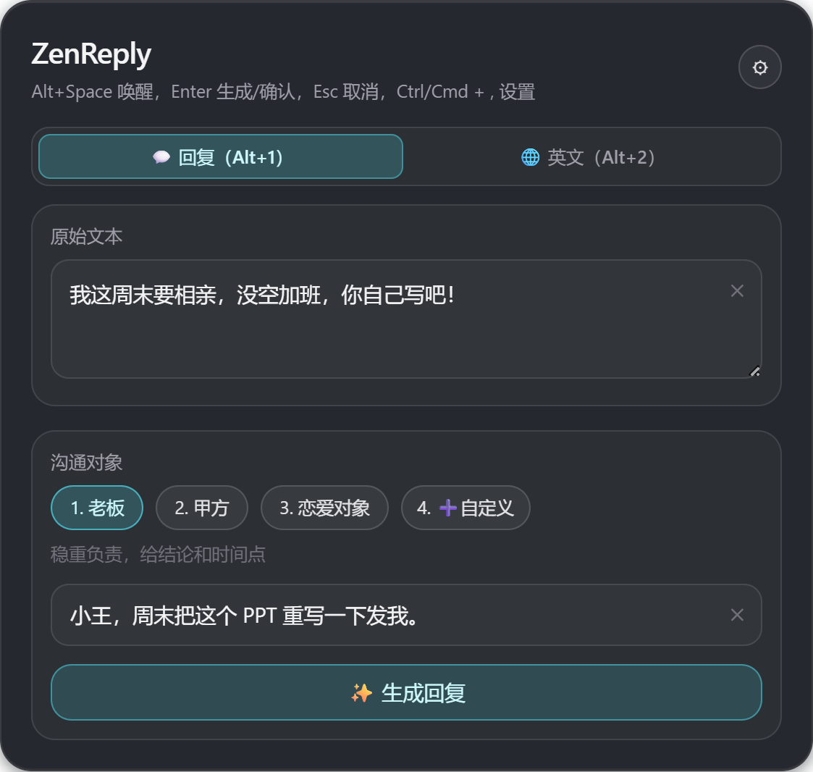
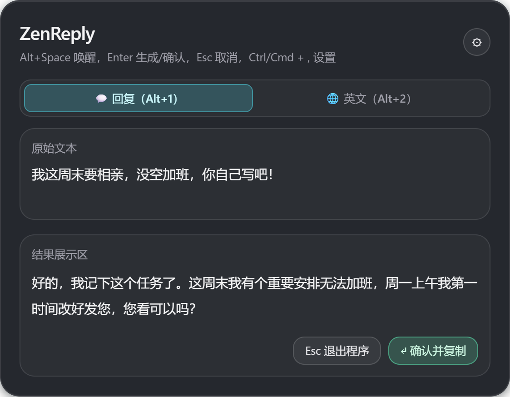
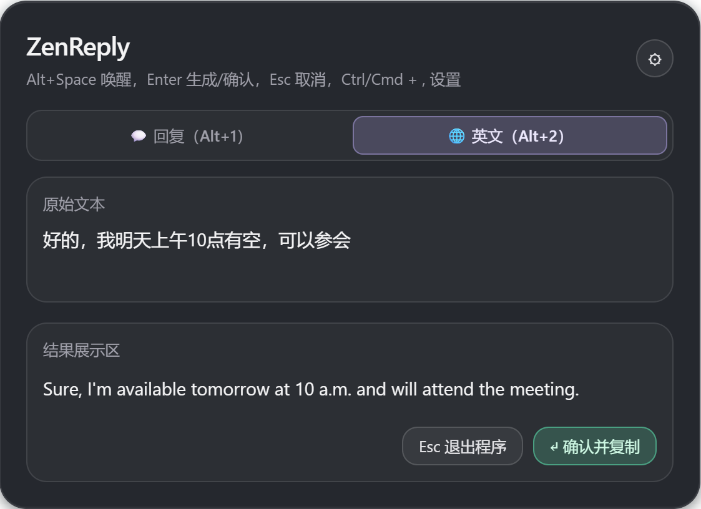

## 简介

常驻系统托盘的桌面小工具。在任意聊天软件里选中一段话，按 `Alt+Space` 呼出面板，选好沟通对象，它就会把你带情绪的草稿改写成可以直接发出去的回复；也可以切到英文翻译模式。需要自备 OpenAI 兼容接口的 API Key，文本会发给你自己配置的模型服务商。

## 截图

## 亮点

- 选中即用：Rust 端先用 enigo 模拟复制拿到选中文本，再弹出面板；微信这类响应慢的应用有兜底轮询。
- 按对象切换策略：内置老板 / 甲方 / 恋爱对象三种预设，也可以自定义身份并自动推断关系；英文翻译有正式、轻松、邮件、简洁四种风格。结果流式生成，确认后写入剪贴板。
- 全程键盘操作，关闭后隐藏到托盘；用 GitHub Actions 构建 Windows / macOS / Linux 安装包。

## 技术栈

Tauri v2 · Rust · React 19 · TypeScript · Tailwind CSS v4 · OpenAI 兼容 API

## 状态

v0.1.1 已于 2026-03-04 发布。

## 仓库

::github{repo="mirawind/zen-reply"}
